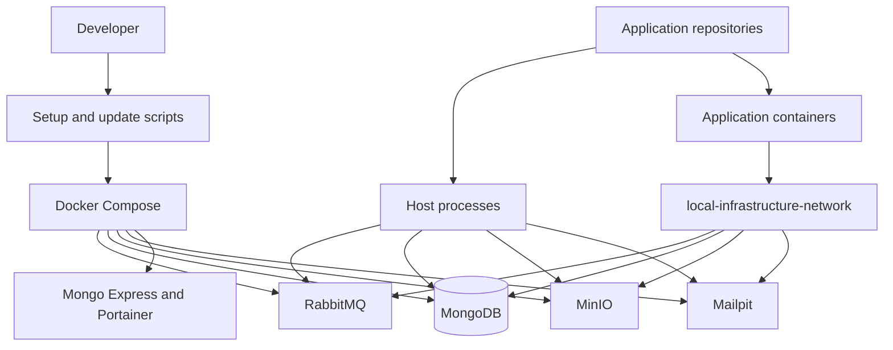

# Local Infrastructure
[Español](README.md)

`local-infrastructure` is a reusable orchestration layer for local development environments. It provides shared Docker services, environment configuration, repository bootstrap utilities, and operational documentation without coupling the environment to a particular application, organization, or technology stack.

Application repositories remain independent. They can use any runtime and are stored locally under `repositorios/` when managed from this workspace.

## Overview

```text
Application repositories
        |
        v
Local Infrastructure
        |
        +-- RabbitMQ
        +-- MongoDB
        +-- MinIO
        +-- Mailpit
        +-- Development tools
```

The root Compose configuration runs only shared backing services. Application containers, source code, build contexts, and framework commands belong to their respective repositories.

## Features

- Docker Compose orchestration for shared local services
- Persistent Docker volumes for stateful services
- Local-only port bindings
- Generated development credentials stored in an ignored `.env` file
- Bash setup workflow for WSL and Linux
- Optional cloning of application repositories into `repositorios/`
- Safe Git update workflow for repositories with configured upstream branches
- Shared Docker network for containerized applications
- Service health checks for RabbitMQ, MongoDB, and MinIO

## Requirements

- WSL or Linux with Bash
- `sudo` access and internet connectivity for an initial automatic installation
- Debian or Ubuntu when automatic host provisioning is required

The same `setup-local.sh` workflow runs in WSL and Linux. On Debian or Ubuntu, it installs missing Git, Docker Engine, and the Docker Compose plugin, then starts Docker Engine. If the tools already exist, it validates them without reinstalling anything.

On other Linux distributions, the script runs normally when Git, Docker Engine, Docker Compose v2, `od`, and `tr` are already installed. If a required tool is missing, it exits with a clear message because automatic provisioning is intentionally limited to Debian and Ubuntu.

On Windows, install and run Docker Engine inside the WSL distribution that contains this repository. This workflow does not use a Windows-hosted container runtime. No application runtime, package manager, or framework is installed by this repository.

## Repository Structure

```text
local-infrastructure/
├── .env.example
├── .gitattributes
├── .gitignore
├── AGENTS.md
├── README.en.md
├── README.md
├── docker-compose.yml
├── docs/
│   ├── application-repositories.md
│   ├── direct-upload-architecture.md
│   ├── internationalization.md
│   ├── local-services.md
│   └── timezone-handling.md
├── repositorios/
│   └── .gitkeep
├── setup-local.sh
└── update-local.sh
```

## Quick Start

```bash
git clone <repository-url>
cd local-infrastructure
bash ./setup-local.sh
```

The setup script installs missing host prerequisites on supported distributions, validates the Docker daemon, creates an ignored `.env` file with generated local credentials, and starts the shared services.

If setup adds the current user to the `docker` group, open a new WSL or Linux session before running Docker commands without `sudo`. Until then, use the Docker command printed by setup.

To clone application repositories during setup, pass each repository with a local directory name:

```bash
bash ./setup-local.sh \
  --repository backend=<git-url> \
  --repository frontend=<git-url> \
  --repository landing=<git-url>
```

Each repository is cloned to `repositorios/<name>`. The script does not install application dependencies or start applications because those actions depend on each repository's technology and conventions.

## Environment Configuration

`.env.example` contains non-sensitive configuration such as local ports, service usernames, and the shared Docker network name. `setup-local.sh` copies it to `.env` and appends generated passwords.

Do not commit `.env`. To regenerate local credentials, reset the local service data, delete `.env`, then run setup again:

```bash
docker compose down --volumes
rm .env
bash ./setup-local.sh
```

This removes all local infrastructure data because stateful services apply their initial credentials only when their data volumes are created.

The generated file contains values in this form:

```env
RABBITMQ_PASSWORD=<generated-local-password>
MONGODB_PASSWORD=<generated-local-password>
MONGO_EXPRESS_PASSWORD=<generated-local-password>
MINIO_ROOT_PASSWORD=<generated-local-password>
```

MinIO starts without buckets or lifecycle rules. Applications create and configure the buckets they require.

## First Access and Credentials

`setup-local.sh` creates `.env` only when it does not already exist. It copies the configured local usernames and generates the required passwords. No manual account creation is required for RabbitMQ, MongoDB, Mongo Express, or MinIO on a clean setup.

Open `.env` only in a trusted local editor when a service or application requires its credentials. Do not print its contents in a terminal, share it, or commit it.

First-run flow:

1. Run `docker compose ps` and wait for the required service health checks. If setup reported temporary `sudo` access, use the command it printed instead.
2. Open `https://localhost:9443` and create the local Portainer administrator account.
3. Use the corresponding `.env` values when signing in to RabbitMQ, Mongo Express, or MinIO, or when configuring a MongoDB or RabbitMQ client.
4. Configure each application with the shared-service values it needs in that application's own ignored environment file.

| Service | First access | Credential source |
| --- | --- | --- |
| RabbitMQ | Sign in to the management UI or configure an AMQP client. | `RABBITMQ_USERNAME` and `RABBITMQ_PASSWORD` in `.env` |
| MongoDB | Configure an application or client with authenticated MongoDB access. | `MONGODB_USERNAME` and `MONGODB_PASSWORD` in `.env` |
| Mongo Express | Sign in through HTTP basic authentication. | `MONGO_EXPRESS_USERNAME` and `MONGO_EXPRESS_PASSWORD` in `.env` |
| MinIO | Sign in to the console or configure an S3-compatible client. | `MINIO_ROOT_USER` and `MINIO_ROOT_PASSWORD` in `.env` |
| Mailpit | Open the web UI or send mail through SMTP. | No authentication is configured. |
| Portainer | Open the HTTPS UI after the first startup and create its local administrator account. | Stored in the persistent `portainer_data` volume, not in `.env` |

Use placeholders, never generated values, when documenting application configuration:

```text
amqp://<RABBITMQ_USERNAME>:<RABBITMQ_PASSWORD>@localhost:<RABBITMQ_AMQP_PORT>
mongodb://<MONGODB_USERNAME>:<MONGODB_PASSWORD>@localhost:<MONGODB_PORT>/?authSource=admin
```

Application repositories own their environment files. Configure shared-service values in each application's ignored local environment file as needed; this repository does not copy infrastructure credentials into applications automatically.

## Starting the Environment

After initial setup, start all shared services with:

```bash
docker compose up -d
```

Inspect status and logs with:

```bash
docker compose ps
docker compose logs -f
```

## Stopping the Environment

Stop containers while retaining data volumes:

```bash
docker compose down
```

To remove all local service data permanently:

```bash
docker compose down --volumes
```

## Refreshing Service Images

This repository does not build application images. Refresh the configured infrastructure images with:

```bash
docker compose pull
docker compose up -d
```

Use `docker compose up -d --force-recreate` when configuration changes require recreating containers.

## Updating Application Repositories

Update clean repositories under `repositorios/` on their currently checked-out branch:

```bash
bash ./update-local.sh
```

The script fetches remote updates and fast-forwards repositories with a configured upstream branch. It skips repositories with local changes, local-only commits, divergent history, detached HEADs, or missing upstream configuration.

Use `--force` only when local changes may be discarded. It resets affected repositories to their upstream branch and removes untracked files:

```bash
bash ./update-local.sh --force
```

## Services

| Service | Purpose | Local endpoint | Authentication |
| --- | --- | --- | --- |
| RabbitMQ | Message broker and management UI | `amqp://localhost:5672`, `http://localhost:15672` | `.env` RabbitMQ credentials |
| MongoDB | Document database | `mongodb://localhost:27017` | `.env` MongoDB credentials |
| Mongo Express | MongoDB web administration | `http://localhost:8081` | `.env` Mongo Express credentials |
| MinIO | S3-compatible object storage and console | `http://localhost:9000`, `http://localhost:9001` | `.env` MinIO credentials |
| Mailpit | Development SMTP server and email viewer | SMTP `localhost:1025`, `http://localhost:8025` | None |
| Portainer | Docker environment administration | `http://localhost:9002`, `https://localhost:9443` | Create local administrator on first access |

All ports bind to `127.0.0.1` and can be changed in `.env` before startup.

## Architecture



Host-run applications connect through `localhost`. Containerized applications can join the shared Docker network and use Compose service names such as `rabbitmq`, `mongo`, `minio`, and `mailpit`.

## Working with Application Repositories

Application repositories are normal Git repositories located directly under `repositorios/`; they are not submodules. Each repository owns its branches, dependencies, environment configuration, tests, and development commands.

For a containerized application, join the network configured by `LOCAL_INFRA_NETWORK`:

```yaml
networks:
  local-infrastructure:
    external: true
    name: local-infrastructure-network
```

Attach the application service to that network. It can then resolve the shared service names from `docker-compose.yml`. See [Application Repositories](docs/application-repositories.md) for host and container integration details.

## Common Commands

| Command | Description |
| --- | --- |
| `bash ./setup-local.sh` | Generate local configuration and start shared services. |
| `bash ./setup-local.sh --repository name=<git-url>` | Clone a repository into `repositorios/name` and start shared services. |
| `bash ./update-local.sh` | Safely update eligible repositories in `repositorios/`. |
| `bash ./update-local.sh --force` | Reset eligible repositories to their upstream branch, discarding local work. |
| `docker compose up -d` | Start shared services. |
| `docker compose down` | Stop shared services while preserving volumes. |
| `docker compose down --volumes` | Stop services and delete persistent local data. |
| `docker compose ps` | Show service status and health. |
| `docker compose logs -f` | Follow service logs. |
| `docker compose pull` | Download updated configured service images. |

## Troubleshooting

| Problem | Resolution |
| --- | --- |
| Docker Engine is unavailable | The setup script attempts to start it. If that fails, start Docker Engine in the current WSL or Linux environment and confirm `docker info` succeeds. |
| Automatic provisioning is unavailable | Use Debian or Ubuntu, or install Git, Docker Engine, Docker Compose v2, `od`, and `tr` before running setup on another Linux distribution. |
| A service cannot bind its port | Change the corresponding port variable in `.env`, then run `docker compose up -d`. |
| Compose reports a missing environment variable | Run `bash ./setup-local.sh` to create `.env`, or restore the required local value without committing it. |
| Mongo Express waits for MongoDB | Run `docker compose ps` and wait until MongoDB is healthy. Inspect `docker compose logs mongo` if it does not become healthy. |
| An application container cannot resolve a shared service | Attach the application Compose service to `local-infrastructure-network`. |
| Local data needs a clean reset | Run `docker compose down --volumes`, then `bash ./setup-local.sh`. This permanently deletes local infrastructure data. |
| Repository update is skipped | Resolve local changes, configure an upstream branch, or use `--force` only after confirming local work can be discarded. |

## Security

- Never commit `.env`, generated credentials, tokens, or private repository URLs.
- Keep `.env.example` limited to non-sensitive defaults and placeholders.
- Use the generated credentials only for local development.
- Bind services to localhost unless a deliberate development requirement says otherwise.
- In WSL, keep the repository in the Linux filesystem when local file permissions must be enforced.
- Use a secret manager and production-specific access controls outside local development.

## Adding a New Project

Clone or create a repository under `repositorios/`:

```text
local-infrastructure/
├── repositorios/
│   ├── backend/
│   ├── frontend/
│   └── worker/
└── docker-compose.yml
```

Start the application using its own documentation. For applications running on the host, configure local service endpoints from the [Services](#services) table. For application containers, join the shared Docker network.

## Documentation

- [Local Services](docs/local-services.md)
- [Application Repositories](docs/application-repositories.md)
- [Direct Upload Architecture](docs/direct-upload-architecture.md)
- [Internationalization](docs/internationalization.md)
- [Timezone Handling](docs/timezone-handling.md)

## Contributing

1. Create a branch.
2. Make focused, generic infrastructure changes.
3. Validate shell syntax and Compose configuration.
4. Update documentation when behavior changes.
5. Open a pull request with the verification results.
