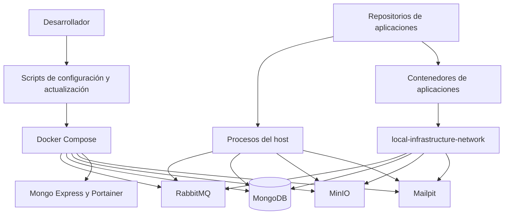

# Infraestructura Local
[English](README.en.md)

`local-infrastructure` es una capa de orquestación reutilizable para entornos de desarrollo locales. Proporciona servicios compartidos de Docker, configuración de entorno, utilidades de inicialización de repositorios y documentación operativa sin acoplar el entorno a una aplicación, organización o pila tecnológica concretas.

Los repositorios de aplicaciones se mantienen independientes. Pueden utilizar cualquier runtime y se almacenan localmente en `repositorios/` cuando se gestionan desde este espacio de trabajo.

## Descripción General

```text
Repositorios de aplicaciones
        |
        v
Infraestructura Local
        |
        +-- RabbitMQ
        +-- MongoDB
        +-- MinIO
        +-- Mailpit
        +-- Herramientas de desarrollo
```

La configuración Compose raíz ejecuta únicamente servicios compartidos de respaldo. Los contenedores de aplicaciones, el código fuente, los contextos de compilación y los comandos de los frameworks pertenecen a sus respectivos repositorios.

## Características

- Orquestación con Docker Compose para servicios locales compartidos
- Volúmenes persistentes de Docker para servicios con estado
- Enlaces de puertos exclusivamente locales
- Credenciales de desarrollo generadas y almacenadas en un archivo `.env` ignorado
- Flujo de configuración con Bash para WSL y Linux
- Clonación opcional de repositorios de aplicaciones en `repositorios/`
- Flujo seguro de actualización de Git para repositorios con ramas upstream configuradas
- Red compartida de Docker para aplicaciones en contenedores
- Comprobaciones de estado de servicio para RabbitMQ, MongoDB y MinIO

## Requisitos

- WSL o Linux con Bash
- Acceso a `sudo` y conectividad a Internet para una instalación automática inicial
- Debian o Ubuntu cuando se requiera el aprovisionamiento automático del host

El mismo flujo `setup-local.sh` se ejecuta en WSL y Linux. En Debian o Ubuntu, instala Git, Docker Engine y el complemento Docker Compose que falten, y después inicia Docker Engine. Si las herramientas ya existen, las valida sin reinstalar nada.

En otras distribuciones de Linux, el script se ejecuta normalmente cuando Git, Docker Engine, Docker Compose v2, `od` y `tr` ya están instalados. Si falta una herramienta necesaria, finaliza con un mensaje claro porque el aprovisionamiento automático se limita intencionadamente a Debian y Ubuntu.

En Windows, instale y ejecute Docker Engine dentro de la distribución de WSL que contiene este repositorio. Este flujo no utiliza un runtime de contenedores alojado en Windows. Este repositorio no instala ningún runtime de aplicaciones, gestor de paquetes ni framework.

## Estructura del Repositorio

```text
local-infrastructure/
├── .env.example
├── .gitattributes
├── .gitignore
├── AGENTS.md
├── README.en.md
├── README.md
├── docker-compose.yml
├── docs/
│   ├── application-repositories.md
│   ├── direct-upload-architecture.md
│   ├── internationalization.md
│   ├── local-services.md
│   └── timezone-handling.md
├── repositorios/
│   └── .gitkeep
├── setup-local.sh
└── update-local.sh
```

## Inicio Rápido

```bash
git clone <repository-url>
cd local-infrastructure
bash ./setup-local.sh
```

El script de configuración instala los requisitos previos del host que falten en las distribuciones compatibles, valida el daemon de Docker, crea un archivo `.env` ignorado con credenciales locales generadas e inicia los servicios compartidos.

Si la configuración añade al usuario actual al grupo `docker`, abra una nueva sesión de WSL o Linux antes de ejecutar comandos de Docker sin `sudo`. Hasta entonces, use el comando de Docker que imprima la configuración.

Para clonar repositorios de aplicaciones durante la configuración, indique cada repositorio con un nombre de directorio local:

```bash
bash ./setup-local.sh \
  --repository backend=<git-url> \
  --repository frontend=<git-url> \
  --repository landing=<git-url>
```

Cada repositorio se clona en `repositorios/<name>`. El script no instala dependencias de aplicaciones ni inicia aplicaciones porque esas acciones dependen de la tecnología y las convenciones de cada repositorio.

## Configuración del Entorno

`.env.example` contiene configuración no sensible, como puertos locales, nombres de usuario de servicios y el nombre de la red Docker compartida. `setup-local.sh` lo copia a `.env` y añade contraseñas generadas.

No versione `.env` en Git. Para regenerar las credenciales locales, restablezca los datos de los servicios locales, elimine `.env` y vuelva a ejecutar la configuración:

```bash
docker compose down --volumes
rm .env
bash ./setup-local.sh
```

Esto elimina todos los datos de la infraestructura local porque los servicios con estado aplican sus credenciales iniciales únicamente cuando se crean sus volúmenes de datos.

El archivo generado contiene valores de esta forma:

```env
RABBITMQ_PASSWORD=<generated-local-password>
MONGODB_PASSWORD=<generated-local-password>
MONGO_EXPRESS_PASSWORD=<generated-local-password>
MINIO_ROOT_PASSWORD=<generated-local-password>
```

MinIO se inicia sin buckets ni reglas de ciclo de vida. Las aplicaciones crean y configuran los buckets que requieren.

## Primer Acceso y Credenciales

`setup-local.sh` crea `.env` únicamente cuando aún no existe. Copia los nombres de usuario locales configurados y genera las contraseñas necesarias. No se requiere crear cuentas manualmente para RabbitMQ, MongoDB, Mongo Express ni MinIO en una configuración limpia.

Abra `.env` únicamente en un editor local de confianza cuando un servicio o una aplicación requiera sus credenciales. No imprima su contenido en una terminal, no lo comparta ni lo confirme en Git.

Flujo de la primera ejecución:

1. Ejecute `docker compose ps` y espere las comprobaciones de estado necesarias de los servicios. Si la configuración informó acceso temporal mediante `sudo`, use en su lugar el comando que imprimió.
2. Abra `https://localhost:9443` y cree la cuenta local de administrador de Portainer.
3. Utilice los valores correspondientes de `.env` al iniciar sesión en RabbitMQ, Mongo Express o MinIO, o al configurar un cliente de MongoDB o RabbitMQ.
4. Configure cada aplicación con los valores de servicios compartidos que necesite en el archivo de entorno ignorado propio de esa aplicación.

| Servicio | Primer acceso | Origen de las credenciales |
| --- | --- | --- |
| RabbitMQ | Inicie sesión en la UI de administración o configure un cliente AMQP. | `RABBITMQ_USERNAME` y `RABBITMQ_PASSWORD` en `.env` |
| MongoDB | Configure una aplicación o cliente con acceso autenticado a MongoDB. | `MONGODB_USERNAME` y `MONGODB_PASSWORD` en `.env` |
| Mongo Express | Inicie sesión mediante autenticación básica HTTP. | `MONGO_EXPRESS_USERNAME` y `MONGO_EXPRESS_PASSWORD` en `.env` |
| MinIO | Inicie sesión en la consola o configure un cliente compatible con S3. | `MINIO_ROOT_USER` y `MINIO_ROOT_PASSWORD` en `.env` |
| Mailpit | Abra la UI web o envíe correo mediante SMTP. | No hay autenticación configurada. |
| Portainer | Abra la UI HTTPS después del primer inicio y cree su cuenta local de administrador. | Se almacena en el volumen persistente `portainer_data`, no en `.env` |

Use marcadores de posición, nunca valores generados, al documentar la configuración de aplicaciones:

```text
amqp://<RABBITMQ_USERNAME>:<RABBITMQ_PASSWORD>@localhost:<RABBITMQ_AMQP_PORT>
mongodb://<MONGODB_USERNAME>:<MONGODB_PASSWORD>@localhost:<MONGODB_PORT>/?authSource=admin
```

Los repositorios de aplicaciones son propietarios de sus archivos de entorno. Configure los valores de servicios compartidos en el archivo de entorno local ignorado de cada aplicación según sea necesario; este repositorio no copia automáticamente las credenciales de infraestructura en las aplicaciones.

## Inicio del Entorno

Después de la configuración inicial, inicie todos los servicios compartidos con:

```bash
docker compose up -d
```

Inspeccione el estado y los registros con:

```bash
docker compose ps
docker compose logs -f
```

## Detención del Entorno

Detenga los contenedores conservando los volúmenes de datos:

```bash
docker compose down
```

Para eliminar permanentemente todos los datos de los servicios locales:

```bash
docker compose down --volumes
```

## Actualización de Imágenes de Servicios

Este repositorio no compila imágenes de aplicaciones. Actualice las imágenes de infraestructura configuradas con:

```bash
docker compose pull
docker compose up -d
```

Use `docker compose up -d --force-recreate` cuando los cambios de configuración requieran recrear los contenedores.

## Actualización de Repositorios de Aplicaciones

Actualice los repositorios limpios en `repositorios/` en la rama actualmente activa:

```bash
bash ./update-local.sh
```

El script obtiene actualizaciones remotas y realiza avance rápido en los repositorios con una rama upstream configurada. Omite repositorios con cambios locales, commits solo locales, historial divergente, HEAD separados o configuración upstream faltante.

Use `--force` únicamente cuando los cambios locales puedan descartarse. Restablece los repositorios afectados a su rama upstream y elimina archivos sin seguimiento:

```bash
bash ./update-local.sh --force
```

## Servicios

| Servicio | Propósito | Endpoint local | Autenticación |
| --- | --- | --- | --- |
| RabbitMQ | Broker de mensajes y UI de administración | `amqp://localhost:5672`, `http://localhost:15672` | Credenciales de RabbitMQ en `.env` |
| MongoDB | Base de datos documental | `mongodb://localhost:27017` | Credenciales de MongoDB en `.env` |
| Mongo Express | Administración web de MongoDB | `http://localhost:8081` | Credenciales de Mongo Express en `.env` |
| MinIO | Almacenamiento de objetos compatible con S3 y consola | `http://localhost:9000`, `http://localhost:9001` | Credenciales de MinIO en `.env` |
| Mailpit | Servidor SMTP de desarrollo y visor de correos electrónicos | SMTP `localhost:1025`, `http://localhost:8025` | Ninguna |
| Portainer | Administración del entorno Docker | `http://localhost:9002`, `https://localhost:9443` | Cree un administrador local en el primer acceso |

Todos los puertos se enlazan a `127.0.0.1` y pueden cambiarse en `.env` antes del inicio.

## Arquitectura



Las aplicaciones ejecutadas en el host se conectan mediante `localhost`. Las aplicaciones en contenedores pueden unirse a la red Docker compartida y usar nombres de servicios de Compose como `rabbitmq`, `mongo`, `minio` y `mailpit`.

## Trabajo con Repositorios de Aplicaciones

Los repositorios de aplicaciones son repositorios Git normales ubicados directamente en `repositorios/`; no son submódulos. Cada repositorio es propietario de sus ramas, dependencias, configuración de entorno, pruebas y comandos de desarrollo.

Para una aplicación en contenedor, únase a la red configurada por `LOCAL_INFRA_NETWORK`:

```yaml
networks:
  local-infrastructure:
    external: true
    name: local-infrastructure-network
```

Conecte el servicio de la aplicación a esa red. De esta forma podrá resolver los nombres de servicios compartidos de `docker-compose.yml`. Consulte [Repositorios de Aplicaciones](docs/application-repositories.md) para conocer los detalles de integración en host y contenedores.

## Comandos Habituales

| Comando | Descripción |
| --- | --- |
| `bash ./setup-local.sh` | Genera la configuración local e inicia los servicios compartidos. |
| `bash ./setup-local.sh --repository name=<git-url>` | Clona un repositorio en `repositorios/name` e inicia los servicios compartidos. |
| `bash ./update-local.sh` | Actualiza de forma segura los repositorios aptos en `repositorios/`. |
| `bash ./update-local.sh --force` | Restablece los repositorios aptos a su rama upstream y descarta el trabajo local. |
| `docker compose up -d` | Inicia los servicios compartidos. |
| `docker compose down` | Detiene los servicios compartidos y conserva los volúmenes. |
| `docker compose down --volumes` | Detiene los servicios y elimina los datos locales persistentes. |
| `docker compose ps` | Muestra el estado y la salud de los servicios. |
| `docker compose logs -f` | Sigue los registros de los servicios. |
| `docker compose pull` | Descarga las imágenes actualizadas de los servicios configurados. |

## Solución de Problemas

| Problema | Resolución |
| --- | --- |
| Docker Engine no está disponible | El script de configuración intenta iniciarlo. Si falla, inicie Docker Engine en el entorno actual de WSL o Linux y confirme que `docker info` se ejecute correctamente. |
| El aprovisionamiento automático no está disponible | Use Debian o Ubuntu, o instale Git, Docker Engine, Docker Compose v2, `od` y `tr` antes de ejecutar la configuración en otra distribución de Linux. |
| Un servicio no puede enlazar su puerto | Cambie la variable de puerto correspondiente en `.env` y ejecute `docker compose up -d`. |
| Compose informa de una variable de entorno faltante | Ejecute `bash ./setup-local.sh` para crear `.env`, o restaure el valor local necesario sin confirmarlo en Git. |
| Mongo Express espera a MongoDB | Ejecute `docker compose ps` y espere hasta que MongoDB esté saludable. Inspeccione `docker compose logs mongo` si no llega a estar saludable. |
| Un contenedor de aplicación no puede resolver un servicio compartido | Conecte el servicio Compose de la aplicación a `local-infrastructure-network`. |
| Los datos locales necesitan un restablecimiento limpio | Ejecute `docker compose down --volumes` y después `bash ./setup-local.sh`. Esto elimina permanentemente los datos de infraestructura local. |
| Se omite la actualización de un repositorio | Resuelva los cambios locales, configure una rama upstream o use `--force` solo después de confirmar que el trabajo local puede descartarse. |

## Seguridad

- Nunca versione `.env`, credenciales generadas, tokens ni URL de repositorios privados en Git.
- Mantenga `.env.example` limitado a valores predeterminados y marcadores de posición no sensibles.
- Use las credenciales generadas únicamente para desarrollo local.
- Enlace los servicios a localhost salvo que un requisito de desarrollo deliberado indique lo contrario.
- En WSL, mantenga el repositorio en el sistema de archivos de Linux cuando sea necesario aplicar permisos locales a los archivos.
- Use un gestor de secretos y controles de acceso específicos de producción fuera del desarrollo local.

## Adición de un Nuevo Proyecto

Clone o cree un repositorio en `repositorios/`:

```text
local-infrastructure/
├── repositorios/
│   ├── backend/
│   ├── frontend/
│   └── worker/
└── docker-compose.yml
```

Inicie la aplicación con su propia documentación. Para las aplicaciones que se ejecutan en el host, configure los endpoints de los servicios locales de la tabla [Servicios](#servicios). Para los contenedores de aplicaciones, únase a la red Docker compartida.

## Documentación

- [Servicios Locales](docs/local-services.md)
- [Repositorios de Aplicaciones](docs/application-repositories.md)
- [Arquitectura de Carga Directa](docs/direct-upload-architecture.md)
- [Internacionalización](docs/internationalization.md)
- [Gestión de Zonas Horarias](docs/timezone-handling.md)

## Contribución

1. Cree una rama.
2. Realice cambios de infraestructura concretos y genéricos.
3. Valide la sintaxis de shell y la configuración de Compose.
4. Actualice la documentación cuando cambie el comportamiento.
5. Abra una solicitud de incorporación de cambios con los resultados de la verificación.
